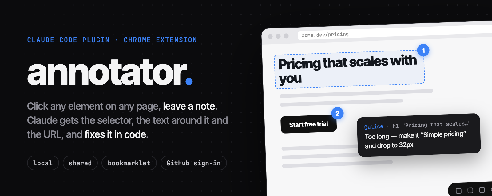
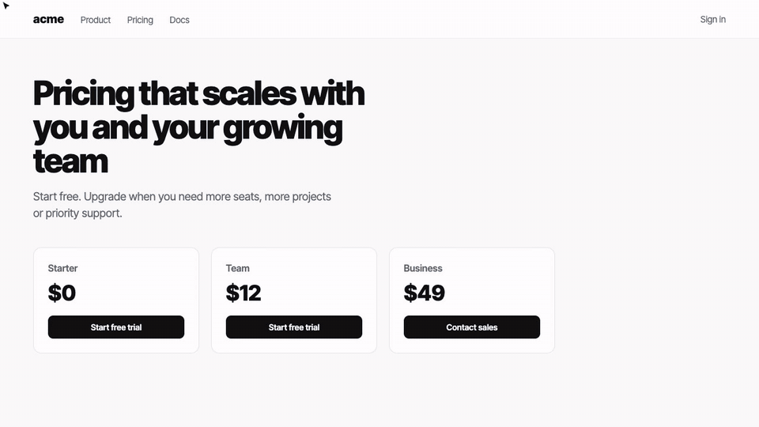

<div align="center">
  <p>
    
  </p>
  <p>
    <a href="https://github.com/Wahajolla/annotator-skill/releases/latest"></a>
    <a href="#install"></a>
    <a href="extension/README.md"></a>
    <a href="LICENSE"></a>
  </p>
</div>

<p align="center">
  
  <br>
  <sub><a href="assets/demo.mp4">Watch as MP4</a></sub>
</p>

A [Claude Code](https://claude.com/claude-code) plugin and Chrome extension for click-to-comment feedback on any web page. Click an element and write a note. Claude gets the note with the element's selector, the text around it, the page URL and the author, finds the element in your code and fixes it.

It is built on [Agentation](https://github.com/benjitaylor/agentation): the toolbar and the `agentation-mcp` notes server.

## Install

In Claude Code:

```
/plugin marketplace add Wahajolla/annotator-skill
/plugin install annotator@wahajolla
```

Then ask:

- "Add the annotator to my dev app" or "I want to annotate this page"
- "Read my notes and fix them"
- "Set up comments on this mock so colleagues can leave feedback"

The skill is `annotator:annotate`. To update the plugin later, run `/plugin marketplace update wahajolla`.

**Chrome extension** (optional, the easiest way to annotate any site):

1. Download `annotator-extension.zip` from the [latest release](https://github.com/Wahajolla/annotator-skill/releases/latest) and unzip it.
2. Open `chrome://extensions`, turn on **Developer mode**, click **Load unpacked** and pick the folder.
3. Press **Alt+Shift+A** on any page.

## Two modes

|  | Local | Shared |
|---|---|---|
| Who comments | you | you and your colleagues |
| Notes server | `localhost:4747`, started by Claude Code (MCP) or `npx -y agentation-mcp server` | hosted wherever you like: Docker, VPS, Fly, Render, Railway… |
| Setup | none | [references/shared.md](skills/annotate/references/shared.md): persistent disk, HTTPS, CORS, one shared session, backups |
| Who wrote a note | always you | GitHub sign-in in the extension |

No server at all? The toolbar also works **copy-only**: press Copy and paste the notes into the chat.

## Put the toolbar anywhere

| Where | How | Notes |
|---|---|---|
| Your React app | `<Agentation endpoint="http://localhost:4747" />` | gate it to dev builds |
| Any HTML page | one `<script>` tag (below) | works without React |
| Any site, no code changes | bookmarklet (below) | blocked on strict-CSP sites |
| Any site, including GitHub and Notion | [Chrome extension](extension/README.md) | no CSP or CORS setup, optional GitHub sign-in |

<details>
<summary><b>Script tag and bookmarklet</b></summary>

Script tag:

```html
<script type="module" src="https://cdn.jsdelivr.net/gh/Wahajolla/annotator-skill@v0.4.0/embed/annotator.js?endpoint=http://localhost:4747"></script>
```

Bookmarklet (save it as a bookmark; clicking it toggles the toolbar):

```
javascript:(()=>{const s=document.createElement('script');s.type='module';s.src='https://cdn.jsdelivr.net/gh/Wahajolla/annotator-skill@v0.4.0/embed/annotator.js?endpoint=http://localhost:4747&t='+Date.now();document.head.appendChild(s)})()
```

[`embed/annotator.js`](embed/annotator.js) takes `endpoint`, `session`, `app` and `hash=1`. Leave out `endpoint` for copy-only mode, and add `session` for shared mode. On a public site, start the notes server with `AGENTATION_CORS_ORIGINS=https://that-site.com`.

</details>

## What Claude gets

Every note arrives with what Claude needs to find the element in your code:

```json
{
  "comment": "@alice: Too long. Make it “Simple pricing”, 40px",
  "authorId": "github:alice",
  "element": "h1 \"Pricing that scales with you and yo\"",
  "fullPath": "body > main > h1",
  "nearbyText": "…",
  "boundingBox": { "x": 56, "y": 150, "width": 640, "height": 172 },
  "url": "https://acme.dev/pricing"
}
```

Claude reads the notes through the agentation MCP tools or with `GET /pending`, fixes the code and marks each note resolved.

## Caveats

- The toolbar is desktop only.
- The notes server has no auth, only CORS. Anyone who can reach it can add and delete notes, and GitHub sign-in is a signature, not access control. Keep backups in shared mode.
- Agentation is licensed under PolyForm Shield. This repo (the skill, loader, extension source and templates) is MIT. The built `extension/dist/toolbar.js` bundles Agentation and React under their own licenses; see [`THIRD_PARTY_LICENSES.txt`](extension/THIRD_PARTY_LICENSES.txt).

## License

[MIT](LICENSE)
